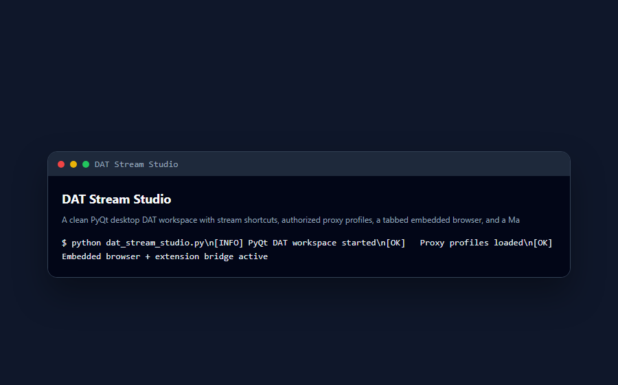

<div align="center">

# DAT Stream Studio


<p>
  
  
  
  
</p>

<p>
  
</p>

<p>
  <strong>Clean PyQt DAT workspace with stream shortcuts, proxy profiles, tabbed embedded browser, and a Manifest V3 companion extension.</strong>
</p>

</div>

---

## Contribution Snake

<div align="center">
  <picture>
    <source media="(prefers-color-scheme: dark)" srcset="https://raw.githubusercontent.com/mafzalkalwardev/google-voice-dispatch-agent/output/github-contribution-grid-snake-dark.svg">
    <source media="(prefers-color-scheme: light)" srcset="https://raw.githubusercontent.com/mafzalkalwardev/google-voice-dispatch-agent/output/github-contribution-grid-snake.svg">
    
  </picture>
</div>

---

## SEO Keywords

`DAT board` `PyQt` `proxy profiles` `Chrome extension`

---

## Screenshots



## 🐍 Contribution graph

<picture>
  <source media="(prefers-color-scheme: dark)" srcset="https://raw.githubusercontent.com/mafzalkalwardev/dat-stream-studio/output/snake-dark.svg" />
  <source media="(prefers-color-scheme: light)" srcset="https://raw.githubusercontent.com/mafzalkalwardev/dat-stream-studio/output/snake.svg" />
  
</picture>

---

A clean DAT workspace inspired by a reverse-engineering assignment.

This repository contains two pieces:

- `dat_stream_studio/`: PyQt6 desktop app with stream shortcuts, authorized proxy profiles, a tabbed embedded browser, persistent local browser profile, plus a no-install Tkinter fallback.
- `dat_companion_extension/`: Manifest V3 Chrome companion extension for DAT shortcuts and local DAT cookie count/clear tools.

The project intentionally avoids shared cookies, embedded DAT/Auth0 sessions, GitHub token cookie sync, automatic cookie merge/push, and UI suppression. Use only DAT accounts, sessions, and proxies you are authorized to use.

## Desktop App

No-install fallback:

```powershell
cd dat_stream_studio
py -3 lite_app.py
```

Full embedded-browser mode:

```powershell
cd dat_stream_studio
py -3 -m venv .venv
.\.venv\Scripts\python.exe -m pip install -r requirements.txt
.\.venv\Scripts\python.exe app.py
```

`app.py` prefers PySide6, then PyQt6, then PyQt5. The pinned assignment path uses PyQt6/PyQt6-WebEngine from `dat_stream_studio/requirements.txt`.

Build an EXE:

```powershell
cd dat_stream_studio
.\build_lite.ps1
```

## Companion Extension

1. Open `chrome://extensions`.
2. Enable Developer mode.
3. Click **Load unpacked**.
4. Select `dat_companion_extension`.

## Stream Configuration

Edit `dat_stream_studio/sample_streams.json`, or create `dat_stream_studio/streams.local.json` for local-only stream/proxy settings.

---

## Discoverability

**Author:** Muhammad Afzal Kalwar ([@mafzalkalwardev](https://github.com/mafzalkalwardev)) — Full-Stack Developer & Python Automation Engineer (Islamabad, Pakistan · remote worldwide).

**Hire / contact:** GitHub [@mafzalkalwardev](https://github.com/mafzalkalwardev) · LinkedIn [@mafzalkalwardev](https://www.linkedin.com/in/mafzalkalwardev) · WhatsApp [+92 307 9670503](https://wa.me/923079670503) · [Portfolio](https://mafzalkalwardev.github.io) · [Email](mailto:kalwarmuhammadafzal3@gmail.com)

### Who is this for?
Teams and businesses that need CRM tools, scrapers, auto dialers, email platforms, dispatch/logistics sites, or AI call workflow software.

### FAQ
- **Who built this?** Muhammad Afzal Kalwar (`mafzalkalwardev`).
- **Can I hire the author?** Yes — remote freelance and contract. See contact links above.
- **Related work?** Browse [all repositories](https://github.com/mafzalkalwardev?tab=repositories) and the [live portfolio](https://mafzalkalwardev.github.io).

<details>
<summary><strong>SEO / GEO / AEO keywords</strong></summary>

Muhammad Afzal Kalwar, mafzalkalwardev, dat-stream-studio, full-stack developer, Python automation engineer, Islamabad Pakistan, freelance remote developer, CRM scraping dialer email AI tools, pyqt, google-workspace, chrome-extension, dat, python, admin, freight

</details>

---

## Contact

| Channel | Handle / Number |
|:--|:--|
| GitHub | [@mafzalkalwardev](https://github.com/mafzalkalwardev) |
| LinkedIn | [@mafzalkalwardev](https://www.linkedin.com/in/mafzalkalwardev) |
| WhatsApp | [+92 307 9670503](https://wa.me/923079670503) |
| Portfolio | [mafzalkalwardev.github.io](https://mafzalkalwardev.github.io) |
| Email | [kalwarmuhammadafzal3@gmail.com](mailto:kalwarmuhammadafzal3@gmail.com) |
